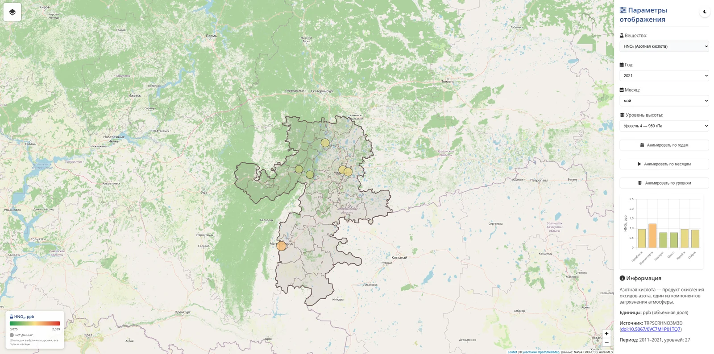
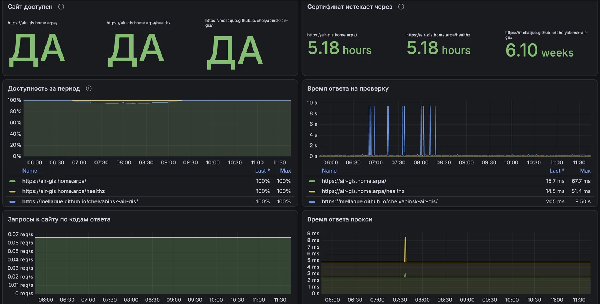

# Веб-ГИС мониторинга качества атмосферного воздуха по спутниковым данным

[](https://github.com/mellaque/chelyabinsk-air-gis/actions/workflows/ci.yml)
[](https://github.com/mellaque/chelyabinsk-air-gis/actions/workflows/security.yml)

Интерактивная карта концентраций загрязнителей воздуха (NO₂, SO₂, CO, O₃, формальдегида, HNO₃)
и водяного пара над Челябинской областью по данным химического реанализа NASA за 2005–2021 годы.

**Демо:** <https://mellaque.github.io/chelyabinsk-air-gis/>

Основной репозиторий — [GitHub](https://github.com/mellaque/chelyabinsk-air-gis): здесь issues,
pull request и основной CI/CD. Зеркала: [GitLab](https://gitlab.com/mellaque/chelyabinsk-air-gis)
(со своим CI — [`.gitlab-ci.yml`](.gitlab-ci.yml)) и [GitVerse](https://gitverse.ru/mellaque/chelyabinsk-air-gis);
это точные копии GitHub, см. [Зеркала](#зеркала).

Проект выполнен как выпускная квалификационная работа (бакалавриат, УУНиТ).

> **Статус:** проект развивается после защиты. Версия в том виде, в каком она защищалась, —
> тег [`v1.0-thesis`](https://github.com/mellaque/chelyabinsk-air-gis/tree/v1.0-thesis).
> Что изменилось — см. [Исправлено после ВКР](#исправлено-после-вкр).



## Возможности

- карта с маркерами городов (Челябинск, Магнитогорск, Златоуст, Миасс, Копейск, Озёрск) и границей области;
- выбор вещества, года, месяца и уровня высоты (уровни давления в гПа);
- анимация по годам, месяцам и уровням;
- график концентраций по городам (Chart.js);
- пропуски в данных показываются серым, а не как нулевая концентрация;
- семь веществ: NO₂, SO₂, CO, O₃, формальдегид, HNO₃ и водяной пар;
- подсказки с названиями районов; во всплывающем окне видно, какие города попали в одну ячейку сетки;
- светлая и тёмная тема, переключение картографических подложек.

## Стек

HTML, CSS, JavaScript, [Leaflet](https://leafletjs.com/), [Chart.js](https://www.chartjs.org/), Font Awesome, шрифт
Open Sans. Библиотеки лежат в репозитории (`vendor/`), а не подключаются с CDN — см. [Библиотеки фронтенда](#библиотеки-фронтенда).
Обработка данных — Python (netCDF4, NumPy). Тесты — pytest, линтер — Ruff, CI — GitHub Actions.
Развёртывание — Docker, nginx (непривилегированный образ), Docker Compose. Сервер — Ansible, Caddy,
Prometheus, Alertmanager, Grafana — см. [Деплой на сервер](#деплой-на-сервер).

## Запуск

### Готовый образ

Образ публикуется в GitHub Container Registry при каждом изменении `main`:

```bash
docker run --rm -p 8080:8080 ghcr.io/mellaque/chelyabinsk-air-gis:latest
```

Сайт откроется на <http://localhost:8080>. Конкретную версию можно взять по тегу: `:2.0.0`, `:sha-<коммит>`.

### Сборка из исходников в Docker

Нужен [Docker Desktop](https://www.docker.com/products/docker-desktop/) (Windows, macOS) или Docker Engine (Linux).

```bash
git clone https://github.com/mellaque/chelyabinsk-air-gis.git
cd chelyabinsk-air-gis
docker compose up -d --build
```

Сайт откроется на <http://localhost:8080>. Остановить: `docker compose down`.

Контейнер работает с минимальными правами: nginx запущен не от root, файловая система только
для чтения, без Linux capabilities. Данные отдаются со сжатием gzip, а браузер при каждом
открытии сверяет их с сервером (ответ 304, если файл не менялся).

### Без Docker

Браузер не загружает JSON-файлы со страницы, открытой напрямую (`file://`),
поэтому нужен любой локальный веб-сервер.

```bash
git clone https://github.com/mellaque/chelyabinsk-air-gis.git
cd chelyabinsk-air-gis
python -m http.server 8000
```

Затем открыть <http://localhost:8000>.

Альтернатива — расширение **Live Server** в VS Code: ПКМ по `index.html` → «Open with Live Server».

## Обновление данных

Готовые JSON уже лежат в `data/`, поэтому для запуска карты этот шаг не нужен.

Все вещества берутся из реанализа NASA TROPESS (TCR-2), список продуктов —
в [`config/substances.json`](config/substances.json). Одна команда скачивает исходные NetCDF
с NASA GES DISC, пересобирает `data/*.json` и проверяет их формат.

### 1. Учётная запись NASA Earthdata (один раз)

1. Зарегистрируйтесь на <https://urs.earthdata.nasa.gov/> (бесплатно).
2. **Applications → Authorized Apps → Approve More Applications** → найдите
   **NASA GESDISC DATA ARCHIVE** → **Approve**. Без этого сервер GES DISC отклоняет загрузку.
3. **Generate Token** → скопируйте токен. Токен действует ограниченное время; когда истечёт, создайте новый.

### 2. Загрузка и обработка

В Docker (Python ставить не нужно):

```bash
export EARTHDATA_TOKEN=<токен>        # или строка EARTHDATA_TOKEN=<токен> в файле .env (он в .gitignore)
docker compose run --rm update         # все вещества, ~2,7 ГБ исходных файлов
docker compose run --rm update co o3   # только указанные
```

Без Docker:

```bash
python -m venv .venv
source .venv/bin/activate              # Windows: .venv\Scripts\activate
pip install -r requirements-dev.txt
export EARTHDATA_TOKEN=<токен>
bash scripts/update_data.sh
```

Отдельные шаги:

```bash
python scripts/download_tcr2.py --substance co --dry-run         # какие файлы будут скачаны (токен не нужен)
python scripts/download_tcr2.py --substance co --years 2015-2021 # скачать в data/raw/co/
python scripts/process_tcr2.py --input data/raw/co --substance co --output data/co_data.json
python scripts/validate_data.py
```

**Загрузчик** ищет файлы в каталоге NASA CMR, скачивает их с токеном Earthdata (токен не передаётся
в облачное хранилище, куда перенаправляет сервер), пропускает уже скачанные файлы, докачивает
прерванные, повторяет запросы при перегрузке сервера и проверяет, что получен именно NetCDF.

**Обработчик** определяет год и месяц по данным внутри файла, пропускает повторно скачанные файлы,
останавливается, если для одного года найдены два разных файла, и переводит единицы
(объёмные доли — в ppb, удельную влажность — в г/кг). Города задаются в
[`config/cities.json`](config/cities.json), формат результата описан в
[`docs/data-format.md`](docs/data-format.md).

Обработка одного вещества из уже скачанных файлов: `docker compose run --rm pipeline`.

### Как добавить вещество

1. Продукт NASA — в [`config/substances.json`](config/substances.json) (ключ, `product`, `units`).
2. Название, описание и цвета — в `config.substances` в [`js/app.js`](js/app.js), ключ тот же.
3. `bash scripts/update_data.sh <ключ>` — скачать и обработать.

Тесты проверяют, что списки веществ в конфиге, на странице и в `data/` совпадают, —
наполовину добавленное вещество не пройдёт CI.

## Разработка, CI и CD

Весь конвейер описан в [`.github/workflows/ci.yml`](.github/workflows/ci.yml).
При каждом pull request и push в `main` запускаются проверки:

| Проверка | Что делает |
|---|---|
| **Линтеры** | actionlint и [zizmor](https://docs.zizmor.sh/) проверяют workflow GitHub Actions (синтаксис, выражения, безопасность, известные уязвимости в actions), shellcheck — shell-скрипты; версии — в `requirements-lint.txt` |
| **Ansible** | ansible-lint (профиль production) проверяет каталог `ansible/`: плейбук, роли, инвентарь; отдельный шаг следит, чтобы в репозиторий не попали файлы ansible-vault; правила алертов Prometheus проверяются тестами (`promtool test rules` из того же образа, что на сервере); версии — в `requirements-ansible.txt` |
| **Ansible — molecule** | отдельная проверка на каждую роль: роль применяется в контейнере с Debian 13 и systemd дважды (второй прогон не должен ничего менять), затем проверяется итог глазами самих программ. `base` — действующие настройки `sshd -T`, правила `nft`, состояние юнитов systemd. `docker` — настоящий Docker CE внутри контейнера (Docker в Docker): откуда установлен пакет, настройки, которые применил демон, сети, ротация журналов у нового контейнера; после перезапуска демона контейнер с `unless-stopped` поднимается, а получивший `docker kill` — нет (см. [случай из практики](#мониторинг-и-алерты)); версии — в `requirements-molecule.txt` |
| **Ruff** | стиль кода и типичные ошибки в Python |
| **pytest** (Python 3.12 и 3.14) | тесты обработки NetCDF → JSON и проверки данных на синтетических файлах; тесты загрузчика на локальном «фальшивом NASA» (каталог, авторизация, редирект без утечки токена, докачка, повторы); тесты синхронизации зеркал на локальных git-репозиториях |
| **Проверка данных** | `scripts/validate_data.py`: все `data/*.json` в актуальном формате, размерности совпадают, нет NaN и отрицательных значений, у проверенных данных указан источник, в `region.geojson` нет битой кодировки |
| **Фронтенд** | файлы в `vendor/` побайтно совпадают с пакетами npm из `package-lock.json`, синтаксис `js/*.js`, подключённые в `index.html` файлы существуют |
| **Docker** | hadolint проверяет Dockerfile, оба образа собираются, контейнер стартует с ограниченными правами и становится healthy, smoke-тест (`scripts/smoke_test.sh`) проверяет страницы, данные, сжатие и заголовки |

Если все проверки прошли и изменения попали в `main`, выполняется публикация:

| Что | Куда |
|---|---|
| Сайт | GitHub Pages — <https://mellaque.github.io/chelyabinsk-air-gis/>, после деплоя проверяется, что страница и данные доступны |
| Образ сайта | `ghcr.io/mellaque/chelyabinsk-air-gis` — теги `latest` и `sha-<коммит>` |
| Образ пайплайна | `ghcr.io/mellaque/chelyabinsk-air-gis-pipeline` |

Тег вида `v2.0.0` публикует образы с номером версии (`:2.0.0`, `:2.0`).
В `main` код попадает только через pull request с зелёными проверками (ruleset ветки).

Публикуется ровно тот образ, который проверен. Сначала образ уходит в реестр без тегов, только по
digest; этот digest запускается с теми же ограничениями, что в `compose.yaml`, проходит smoke-тест
и проверку Trivy и подписывается cosign. Только после этого на него вешаются теги `latest`,
`sha-<коммит>` и версии — без пересборки, так что тег указывает ровно на подписанный digest.
Если проверка не прошла, теги остаются на прежнем образе.

Базовые образы в `Dockerfile` и `Dockerfile.pipeline` закреплены по digest (`образ:тег@sha256:…`),
поэтому сборка не меняется сама по себе, когда под тем же тегом в Docker Hub появляется новый образ.
Dependabot раз в неделю проверяет, не вышел ли он, и присылает pull request с новым digest —
этот PR проходит те же проверки, что любое изменение. Версии Python-пакетов, actions и линтеров
Dependabot обновляет раз в месяц. Новые версии он предлагает не раньше чем через 7 дней после выхода.

Проверки локально:

```bash
pip install -r requirements-dev.txt -r requirements-lint.txt
ruff check .
pytest
python scripts/validate_data.py
actionlint && zizmor --offline . && shellcheck scripts/*.sh
pip install -r requirements-ansible.txt && (cd ansible && ansible-lint)
```

На зеркале GitLab те же проверки описаны в [`.gitlab-ci.yml`](.gitlab-ci.yml) средствами GitLab:
стадии, `parallel:matrix` для версий Python, сборка и smoke-тест образов в docker-in-docker,
Trivy по сохранённым образам из артефактов, встроенные шаблоны SAST и поиска секретов,
отчёты тестов (JUnit) и качества кода (Code Quality) в merge request.

### Библиотеки фронтенда

Leaflet, Chart.js, Font Awesome и шрифт Open Sans подключаются из `vendor/`, а не с CDN: сайт
не зависит от чужих серверов, а Content-Security-Policy в `index.html` разрешает скрипты, стили и
шрифты только со своего адреса. Версии — в `package.json`, архивы и их хеши — в `package-lock.json`;
CI проверяет, что `vendor/` побайтно совпадает с пакетами npm. Обновить библиотеку:

```bash
npm install leaflet@<версия> --save-exact --ignore-scripts   # меняет package.json и package-lock.json
python scripts/vendor_frontend.py                             # копирует нужные файлы в vendor/
```

Версии библиотек фронтенда Dependabot не обновляет — это осознанный шаг по командам выше.
Если он откроет pull request для уязвимой версии, проверка `vendor/` в CI не пройдёт, пока в ветке PR
не выполнить `npm ci --ignore-scripts && python scripts/vendor_frontend.py` и не закоммитить `vendor/`.

### Зеркала

GitHub — источник истины, GitLab и GitVerse — его точные копии: те же ветки и теги на тех же
коммитах. Изменения попадают в `main` только через pull request на GitHub, а на зеркала их переносит
[`scripts/sync_mirrors.sh`](scripts/sync_mirrors.sh): добавляет недостающее, обновляет изменившееся
и удаляет лишнее — в том числе ветки, которые GitHub сам удаляет после мержа pull request.

```bash
sh scripts/sync_mirrors.sh --check   # только показать расхождения
sh scripts/sync_mirrors.sh           # синхронизировать
```

CI на зеркалах: у GitLab свой [`.gitlab-ci.yml`](.gitlab-ci.yml), а GitVerse запускает те же файлы
из `.github/workflows/` на своих раннерах. Там нет API GitHub, Docker, GHCR и Pages, поэтому шаги и jobs,
которым это нужно (сборка образов, Trivy, CodeQL, публикация, онлайн-проверки zizmor), выполняются
только на github.com — условие `github.server_url == 'https://github.com'`. На GitVerse остаются линтеры
(zizmor в режиме `--offline`), ansible-lint, тесты, проверка данных и фронтенда.

Зеркала — только для чтения: то, что запушено прямо в них, будет перезаписано, как при
`git push --mirror`. Если с GitHub не пришло ни одной ветки, скрипт ничего не трогает; локальные
ветки и теги на зеркала не попадают; два запуска одновременно не идут. Тесты — на локальных
репозиториях, без сети ([`tests/test_sync_mirrors.py`](tests/test_sync_mirrors.py)).

Merge-коммиты, которые GitHub создаёт при мерже pull request, подписаны ключом самого GitHub.
GitHub показывает их как Verified, а GitLab и GitVerse — как неподтверждённые («Unverified»,
«Не верифицирован»): ключ GitHub не привязан ни к одной учётной записи на этих площадках.
Для зеркал это ожидаемо; подписи проверяются на GitHub.

## Деплой на сервер

Кроме публичного демо на GitHub Pages, сайт работает на домашнем сервере (Debian 13, бывший ноутбук).
Сервер целиком описан кодом в каталоге [`ansible/`](ansible/): одна команда превращает чистую систему
в настроенную, повторный запуск ничего не меняет (`changed=0`).

```
 браузер
    │ HTTPS
    ▼
┌────────────────────────── сервер ──────────────────────────┐
│ Caddy ──▶ сайт: образ из GHCR по digest, подпись проверена │
│   │                                                        │
│   └─▶ Prometheus · Alertmanager · Grafana (только из VPN)  │
│           │              │                                 │
│   метрики и проверки     ├─▶ ntfy: уведомление на телефон  │
│   сайта каждые 30 с      └─▶ внешний «будильник»: сигнал   │
│                              «мониторинг жив»              │
└────────────────────────────────────────────────────────────┘
```

| Роль | Что делает |
|---|---|
| [`base`](ansible/roles/base/) | пакеты, вход по SSH только по ключу, автоматические обновления безопасности, запрет сна, firewall на nftables с автооткатом: если после применения правил SSH не отвечает, правила снимаются сами |
| [`docker`](ansible/roles/docker/) | Docker CE и Compose из репозитория Docker (ключ сверяется по sha256), ротация журналов, общие сети |
| [`app`](ansible/roles/app/) | проверяет подпись образа cosign на самом сервере и запускает сайт по digest; контейнер без прав, с файловой системой только для чтения и без опубликованных портов |
| [`proxy`](ansible/roles/proxy/) | обратный прокси Caddy: HTTPS с собственным центром сертификации (имена `*.home.arpa`, RFC 8375), сжатие, служебные сайты доступны только из VPN |
| [`monitoring`](ansible/roles/monitoring/) | Prometheus, Alertmanager, Grafana и экспортёры — см. [Мониторинг и алерты](#мониторинг-и-алерты) |

Как это устроено:

- **Выкатка новой версии — pull request на одну строку:** digest образа в
  [`ansible/group_vars/all.yml`](ansible/group_vars/all.yml). Тегов вроде `latest` на сервере нет:
  запускается ровно тот образ, который прошёл CI и был подписан.
- **Все сторонние образы закреплены по digest**, конфигурацию перед заменой проверяет сама программа
  (`sshd -t`, `nft -c`, `caddy adapt`, `promtool check config`, `amtool check-config` и т. д.) —
  файл с ошибкой на сервер не попадает.
- **Секретов в репозитории нет, даже зашифрованных.** Пароль Grafana и адреса для уведомлений лежат
  в файле ansible-vault вне репозитория (образец — [`ansible/vault.example.yml`](ansible/vault.example.yml))
  и попадают в контейнеры отдельными файлами, а не переменными окружения. CI падает, если файл vault
  окажется в репозитории.
- **В инвентаре нет адресов и логинов** — только SSH-алиас; подключение настраивается в `~/.ssh/config`.
- Используются только модули `ansible.builtin`: коллекции ставить не нужно.

Запуск (нужны Ansible, SSH-алиас `homelab` и файл с секретами):

```bash
cd ansible
ansible-playbook playbook.yml -K -e @$HOME/.config/air-gis/vault.yml --ask-vault-pass --check --diff   # предпросмотр
ansible-playbook playbook.yml -K -e @$HOME/.config/air-gis/vault.yml --ask-vault-pass                  # применить
```

Восстановление сервера с нуля — что хранится вне сервера, ручные шаги, проверки и время — описано
в [runbook](docs/runbook-restore.md); сценарий проверен на чистой ВМ.

### Мониторинг и алерты

| Компонент | Зачем |
|---|---|
| **Prometheus** | собирает метрики каждые 30 секунд и вычисляет правила алертов |
| **blackbox_exporter** | проверяет сайт так же, как браузер: по HTTPS через прокси, с проверкой сертификата; отдельно — публичное демо |
| **node_exporter, cAdvisor** | метрики сервера (диск, память, питание) и контейнеров; cAdvisor работает без привилегированного режима |
| **Grafana** | три дашборда — «Сайт», «Сервер», «Контейнеры»; источник данных и дашборды лежат в репозитории, том Grafana можно удалить без потерь |
| **Alertmanager** | группирует алерты и отправляет уведомления в [ntfy](https://ntfy.sh/) |



Правила алертов — обычные файлы в [`roles/monitoring/files/prometheus/rules/`](ansible/roles/monitoring/files/prometheus/rules/):

| Файл | О чём сообщает |
|---|---|
| `site.yml` | сайт не отвечает (две неудачные проверки подряд), недоступно публичное демо, сертификат не обновляется или скоро истечёт |
| `host.yml` | мало места, файловая система стала доступна только для чтения, мало памяти, OOM kill, сервер работает от батареи, батарея разряжается, перезагрузка |
| `containers.yml` | контейнер близок к лимиту памяти или перезапускается |
| `monitoring.yml` | цель не опрашивается, конфигурация не перечиталась, правила вычисляются с ошибками, уведомления не уходят |

- **Правила покрыты тестами** ([`alerts_test.yml`](ansible/roles/monitoring/tests/rules/alerts_test.yml),
  `promtool test rules`): на вход подаются придуманные ряды метрик, проверяется, когда алерт загорается
  и гаснет. Правило с опечаткой в имени метрики синтаксически верно и просто никогда не сработает —
  тест это ловит. В CI promtool берётся из того же образа Prometheus, что работает на сервере:
  `sh scripts/test_alert_rules.sh`.
- **О недоступности сайта уведомление приходит в пределах двух минут** и содержит, что случилось
  и куда смотреть; когда всё починилось — приходит «исправлено». Важность алерта определяет приоритет
  уведомления.
- **Мониторинг следит и за собой.** Всё перечисленное работает на том же сервере, поэтому о выключенном
  сервере или упавшем Prometheus оно сообщить не может. Для этого есть алерт `Watchdog`, который активен
  всегда: Alertmanager каждые несколько минут отправляет его внешнему сервису, и тот поднимает тревогу,
  когда сигналы прекратились (dead man's switch).
- **Случай из практики.** Ночью после автоматического обновления ядра сервер перезагрузился, и Docker
  поднял все контейнеры, кроме Prometheus и blackbox_exporter. Внутренние алерты молчали — их некому
  было вычислять; тревогу поднял внешний сервис. Причина нашлась в исходниках Docker: любой сигнал через
  его API (`docker kill`, даже безобидный SIGHUP для перечитывания конфигурации) помечает контейнер
  как остановленный вручную, и политика `unless-stopped` после перезагрузки его не поднимает. Исправление:
  сигнал посылается изнутри контейнера (`docker compose exec … kill -HUP 1`), роль в конце прогона
  проверяет, что ни один её контейнер не помечен, molecule закрепляет само поведение Docker тестом,
  а в [runbook](docs/runbook-restore.md) добавлена проверка перезагрузкой.

## Безопасность

- **Trivy** проверяет зависимости, оба Docker-образа, секреты и конфигурацию; **CodeQL** — код на Python
  и JavaScript и сами workflow. Отчёты — во вкладке Security, при каждом PR и раз в неделю
  ([`security.yml`](.github/workflows/security.yml)).
- Образ с критической уязвимостью, для которой уже есть исправление, не проходит CI.
- Все GitHub Actions закреплены по хешу коммита, у каждого job — минимальные права;
  workflow при каждом PR проверяют actionlint и [zizmor](https://docs.zizmor.sh/) (job «Линтеры»).
- Страница загружает скрипты, стили и шрифты только со своего адреса: библиотеки лежат в `vendor/`,
  а **Content-Security-Policy** запрещает чужой и встроенный код (тесты следят, чтобы он не появился).
  Уязвимые версии библиотек фронтенда Trivy находит по `package-lock.json`.
- Опубликованные образы подписаны **cosign** (Sigstore, без ключей), к ним приложены **SBOM**
  (список пакетов) и **provenance** (из какого коммита и каким workflow собран образ).

Проверка подписи и политика сообщения об уязвимостях — в [SECURITY.md](SECURITY.md).

## Структура

```
├── index.html                  # страница приложения
├── Dockerfile                  # образ сайта: проверка данных → nginx
├── Dockerfile.pipeline         # образ пайплайна обработки NetCDF
├── compose.yaml                # запуск: docker compose up
├── deploy/nginx.conf           # конфигурация nginx
├── css/map-controls.css        # стили карты и элементов управления
├── css/page.css                # стили страницы
├── js/app.js                   # карта, график, анимации
├── js/theme.js                 # светлая и тёмная тема
├── vendor/                     # Leaflet, Chart.js, Font Awesome, Open Sans — из npm
├── package.json                # версии библиотек фронтенда (хеши — в package-lock.json)
├── config/
│   ├── cities.json             # города и их координаты
│   └── substances.json         # вещества → продукты NASA TCR-2 и единицы
├── data/
│   ├── <вещество>_data.json    # no2, so2, co, o3, ch2o, hno3, h2o: 6 городов, 2005–2021, 27 уровней
│   ├── region.geojson          # граница области и районов
│   └── raw/                    # исходные NetCDF (не хранятся в git)
├── scripts/
│   ├── download_tcr2.py        # загрузка NetCDF с NASA GES DISC
│   ├── process_tcr2.py         # NetCDF (TCR-2) → JSON
│   ├── update_data.sh          # загрузка + обработка + проверка всех веществ
│   ├── validate_data.py        # проверка формата данных (CI и сборка образа)
│   ├── smoke_test.sh           # проверка запущенного сайта
│   ├── test_alert_rules.sh     # правила алертов Prometheus: синтаксис и тесты (promtool)
│   ├── sync_mirrors.sh         # синхронизация зеркал GitLab и GitVerse с GitHub
│   ├── vendor_frontend.py      # библиотеки фронтенда: node_modules → vendor/
│   ├── prepare_region.py       # подготовка границ из выгрузки OSM
│   └── legacy/                 # скрипты версии ВКР
├── ansible/                    # настройка сервера и деплой (Ansible)
│   ├── ansible.cfg             # настройки: инвентарь, формат вывода
│   ├── inventory/hosts.yml     # сервер — только SSH-алиас, без адресов и логинов
│   ├── inventory/restore-test.yml # тестовый стенд для проверки восстановления с нуля
│   ├── group_vars/all.yml      # версия сайта на сервере (digest образа), подсеть сети мониторинга
│   ├── playbook.yml            # плейбук
│   ├── roles/base/             # роль: пакеты, SSH только по ключу, автообновления, часовой пояс, запрет сна, firewall
│   │   └── molecule/default/   # тест роли в контейнере (molecule): применение, повторный прогон, проверки
│   ├── roles/docker/           # роль: Docker CE и Compose из репозитория Docker, ротация журналов контейнеров
│   │   └── molecule/default/   # тест роли в контейнере: Docker в Docker, повторный прогон, перезапуск демона
│   ├── roles/app/              # роль: проверка подписи образа (cosign) и запуск сайта по digest
│   ├── roles/proxy/            # роль: обратный прокси Caddy, HTTPS с собственным центром сертификации
│   ├── roles/monitoring/       # роль: Prometheus, node_exporter, cAdvisor, blackbox_exporter (проверки сайта по HTTPS), метрики Caddy, Grafana с дашбордами из файлов, правила алертов с тестами, Alertmanager с уведомлениями в ntfy и сигналом внешнему «будильнику»
│   └── vault.example.yml       # образец файла с секретами (настоящий — вне репозитория)
├── tests/                      # pytest
├── docs/data-format.md         # описание формата данных
├── docs/runbook-restore.md     # восстановление сервера с нуля
├── SECURITY.md                 # как сообщить об уязвимости, меры безопасности, проверка подписи
├── requirements*.txt           # версии Python-пакетов: пайплайн, разработка, линтеры, Ansible, molecule
├── .gitlab-ci.yml              # CI для зеркала на GitLab
├── .github/
│   ├── workflows/ci.yml        # CI/CD: проверки, публикация образов и сайта
│   ├── workflows/security.yml  # Trivy и CodeQL, в том числе еженедельно
│   └── dependabot.yml          # автообновление зависимостей
└── pyproject.toml              # настройки Ruff и pytest
```

## Данные

Реанализ NASA TROPESS Chemical Reanalysis (TCR-2), NASA JPL / GES DISC: месячные значения
за 2005–2021 годы, 27 уровней давления (1000–60 гПа), сетка 1,125° × 1,125°.

| Вещество | Продукт | Единицы | DOI |
|---|---|---|---|
| HNO₃ | `TRPSCRHNO3M3D` | ppb | [10.5067/0VC7M1P01TQ7](https://doi.org/10.5067/0VC7M1P01TQ7) |
| CO | `TRPSCRCOM3D` | ppb | [10.5067/GT835KMBSI8O](https://doi.org/10.5067/GT835KMBSI8O) |
| O₃ | `TRPSCRO3M3D` | ppb | [10.5067/H6X584OA098S](https://doi.org/10.5067/H6X584OA098S) |
| H₂O (удельная влажность) | `TRPSCRQM3D` | г/кг | [10.5067/5SD4OKARN8F2](https://doi.org/10.5067/5SD4OKARN8F2) |
| NO₂ | `TRPSCRNO2M3D` | ppb | [10.5067/F4FE5VWM9501](https://doi.org/10.5067/F4FE5VWM9501) |
| SO₂ | `TRPSCRSO2M3D` | ppb | [10.5067/546QVG4Q8JZM](https://doi.org/10.5067/546QVG4Q8JZM) |
| CH₂O (формальдегид) | `TRPSCRCH2OM3D` | ppb | [10.5067/6F26QNSI0DNX](https://doi.org/10.5067/6F26QNSI0DNX) |

Исходные файлы NetCDF (36–43 МБ на год) не хранятся в репозитории — их скачивает
`scripts/download_tcr2.py`. Данные NASA распространяются свободно, нужна бесплатная учётная запись
[NASA Earthdata](https://urs.earthdata.nasa.gov/).

Картографическая основа и границы административных единиц (`region.geojson`) — © участники
[OpenStreetMap](https://www.openstreetmap.org/copyright), лицензия [ODbL](https://opendatacommons.org/licenses/odbl/).
Границы взяты из выгрузки OSM в shape-файлах проекта [ГИС-Лаб](http://gis-lab.info/projects/osmshp/)
и конвертированы в GeoJSON в QGIS; затем обработаны скриптом `scripts/prepare_region.py`
(исправлена кодировка названий, оставлены область и районы).

## Исправлено после ВКР

При повторном разборе проекта в версии ВКР нашлись ошибки. Что с ними сделано:

| Проблема в версии ВКР | Сейчас |
|---|---|
| Год вычислялся по номеру файла — все данные HNO₃ сдвинуты на год назад | Год и месяц читаются из переменной времени в файле |
| Файл за 2021 г. обработан дважды, «2022 г.» был его копией | Повторы определяются по SHA-256 и пропускаются |
| Пропуски (уровни ниже поверхности земли) записаны как `0` | Пропуски — `null`, на карте серые маркеры |
| Все значения подписаны как ppm, шкала не соответствовала данным | Единицы берутся из файла (HNO₃ — ppb), шкала строится по данным выбранного уровня |
| Кнопки анимации по годам и уровням не работали (обработчик добавлялся дважды) | Исправлено |
| Названия в `region.geojson` в неправильной кодировке, в файле лишние границы (вся РФ, УрФО) | Кодировка исправлена, оставлены область и районы; файл уменьшился с 1,8 до 0,85 МБ |
| Данные HNO₃ — 3,2 МБ в виде списка записей | Компактный формат, ~150 КБ |
| Ошибка в данных обнаруживалась только в браузере | CI проверяет формат данных при каждом изменении |
| CO и H₂O — значения других регионов, O₃ — непроверяемые данные без исходников | CO, O₃ и H₂O заново скачаны из реанализа TCR-2 и обработаны тем же пайплайном, что HNO₃ |
| HNO₃ только за 2011–2021 | Весь период реанализа, 2005–2021 |

## Ограничения

- **Период 2005–2021.** Реанализ TCR-2 завершён и новыми годами не пополняется.
- **Пространственное разрешение.** Ячейка сетки TCR-2 — около 125 × 70 км, поэтому соседние города
  (Челябинск и Копейск, Миасс и Златоуст) получают одинаковые значения.

## План развития

- [x] Новый пайплайн NetCDF → JSON без промежуточного Excel: год из метаданных, `null` для пропусков, явные единицы
- [x] Отображение пропусков на карте и корректные подписи единиц
- [x] Регион и список городов в конфигурационном файле
- [x] Тесты пайплайна
- [x] CI на GitHub Actions: Ruff, тесты, проверка данных и фронтенда при каждом push и PR
- [x] Docker и Docker Compose: образ сайта на nginx и образ пайплайна
- [x] Публикация образов в GitHub Container Registry
- [x] Деплой сайта на GitHub Pages
- [x] Безопасность цепочки поставок: Trivy, CodeQL, подпись образов, SBOM, закрепление actions
- [x] Деплой контейнера на сервер: Ansible, обратный прокси с HTTPS, проверка подписи образа — см. [Деплой на сервер](#деплой-на-сервер)
- [x] Мониторинг и алерты: Prometheus, Grafana, Alertmanager, тесты правил — см. [Мониторинг и алерты](#мониторинг-и-алерты)
- [x] Тесты ролей base и docker в контейнере (molecule) — в CI при каждом pull request
- [x] Сценарий восстановления сервера с нуля, проверенный на чистой ВМ — см. [runbook](docs/runbook-restore.md)
- [ ] Тесты ролей app, proxy и monitoring в molecule
- [x] Автоматическая загрузка данных с NASA Earthdata
- [x] CO, O₃ и H₂O из реанализа TCR-2 вместо непроверенных данных MLS из версии ВКР
- [x] NO₂, SO₂ и формальдегид из того же реанализа
- [ ] Аэрозоли (сульфаты, нитраты, аммоний — компоненты PM2.5): `TRPSCRAERSO4M3D` и др., нужно проверить единицы

## Лицензия

Код — [MIT](LICENSE). Данные — по условиям их правообладателей (NASA, участники OpenStreetMap).
Библиотеки в `vendor/` — по своим лицензиям (BSD-2-Clause, MIT, SIL OFL 1.1, CC BY 4.0), файлы лицензий лежат рядом.
